<!-- ============ HEADER ============ -->
<p align="center">
  
</p>

<p align="center">
  <a href="https://github.com/maryammoeed">
    
  </a>
</p>

<p align="center">
  <a href="https://www.linkedin.com/in/maryam-moeed-752631247"></a>
  <a href="mailto:maryammoeed68@gmail.com"></a>
  <!-- PORTFOLIO-BADGE: added once the Vercel site is live -->
  
</p>

<p align="center">
  
</p>

---

### 🧠 About me

```python
class Maryam:
    role        = "AI Engineer @ 10Pearls — multi-agent LLM systems in production"
    based_in    = "Islamabad, Pakistan"
    building    = ["multi-agent LLM pipelines", "guardrails & validation layers",
                   "human-in-the-loop review", "LLM evaluation & observability"]
    supervising = "GIKI undergrad team — federated learning + blockchain for rare disease research"
    researching = ["multi-agent coordination", "reliability & safety of agentic AI",
                   "human oversight of autonomous pipelines", "privacy-preserving ML for healthcare"]
    education   = "BS Computer Science, FAST-NUCES — Dean's List (Fall 2023)"

    def current_question(self):
        return "Where should a human step into a long agent chain — and how do we know the agents got it right?"
```

### ⚙️ What I build

<p align="center">
  
</p>

Two years shipping production agent systems in a regulated domain, where outputs have to be **correct, compliant and explainable**:

- **Platform ↔ use case** — users start a run through a kickoff form on the platform; a Python use-case service picks it up and orchestrates the agents, sending status and results back to the platform over **Azure Service Bus**
- **Retrieval** — uploaded files are embedded into a knowledge base so agents can answer questions from the client's own documents
- **Input guardrails** — every input is screened for secrets and prompt injection before it reaches an agent
- **Evaluator loop** — an evaluator agent checks each output against defined rules; anything that fails goes back to the agent, with up to 3 retries
- **Output guardrails** — final responses are checked for toxic language and leaked secrets before they're returned
- **Observability** — **Application Insights** collects logs and traces from every stage for monitoring and debugging
- **Shipping** — async FastAPI on Azure Container Apps with automated CI/CD

---

### 🚀 Featured projects

<table>
<tr>
<td width="50%" valign="top">

#### 📐 LOE Estimation System
Three-stage reasoning pipeline (few-shot → chain-of-thought → structured output) that turns project documents into architecture, work breakdown and FTE estimates, with retrieval-based validation at every stage.

`GPT-4o` `LangChain` `Pinecone`

</td>
<td width="50%" valign="top">

#### 🤖 MentorBot
A self-improving RAG assistant: unanswered questions escalate to human mentors and their answers are ingested automatically. Also automates multi-language PR review that blocks merges until issues are fixed.

`LangChain` `ChromaDB` `Discord API` `GitHub API`

</td>
</tr>
<tr>
<td width="50%" valign="top">

#### 💼 HR Assistant
Organization-wide RAG assistant on Microsoft Teams with validated structured outputs; Langfuse traces used to cut latency and prompt cost.

`Azure` `FastAPI` `Pydantic AI` `ChromaDB` `Langfuse`

</td>
<td width="50%" valign="top">

#### 🚶 Biometric Gait Recognition
Final-year research: PCA + LDA + Maximum Margin Criterion on CMU MoCap sequences — **95.3% CCR** at roughly **1/19th** the compute of PCA/LDA alone.

`Subspace learning` `Python` `CMU MoCap`

</td>
</tr>
</table>

<!-- Tip: link each project title to its repo, e.g. #### [🤖 MentorBot](https://github.com/maryammoeed/REPO) -->

---

### 🧭 Journey

| When | Role | Where |
|---|---|---|
| Aug 2025 – now | **AI Engineer** — production multi-agent LLM systems | 10Pearls |
| Aug 2025 – May 2026 | **Project Supervisor** — federated learning + blockchain for rare disease research | GIKI |
| Jun – Sep 2025 | **AI / Data Science Mentor** | Code for Pakistan |
| Aug 2024 – Jul 2025 | **Associate AI Engineer** — 4+ production LLM systems, team-wide Langfuse evaluation practice | 10Pearls |
| Jul – Nov 2023 | **Data Science Intern** — warehouse digital twin (Prophet + SimPy), PuLP inventory optimization | Royal Cyber |
| 2020 – 2024 | **BS Computer Science** — Dean's List, Fall 2023 | FAST-NUCES |

🏆 Employee of the Month ×2 · Team of the Quarter ×1 at 10Pearls

---

### 🛠️ Tech stack

**Agentic AI & LLMs**
<p>
  
  
  
  
  
  
  
</p>

**Retrieval & data**
<p>
  
  
  
  
  
</p>

**ML, systems & cloud**
<p>
  
</p>

---

### 📊 GitHub activity

<p align="center">
  
  
</p>

<p align="center">
  
</p>

<p align="center">
  
</p>

---

<p align="center">
  <i>Open to conversations about agentic AI reliability, human-in-the-loop systems, and privacy-preserving ML for healthcare.</i>
</p>

<p align="center">
  
</p>
